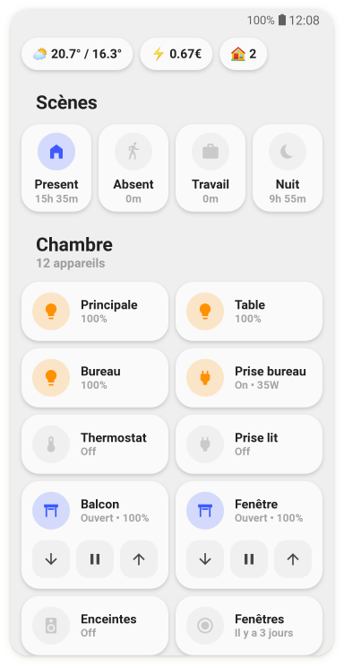
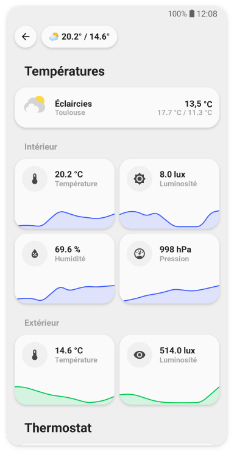
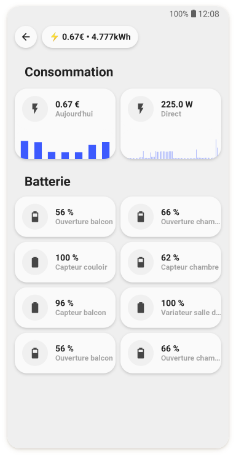
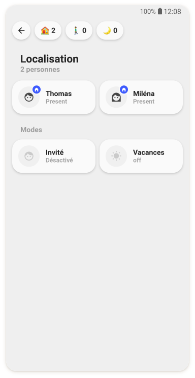
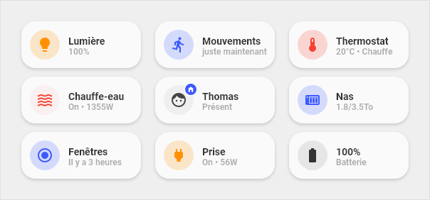
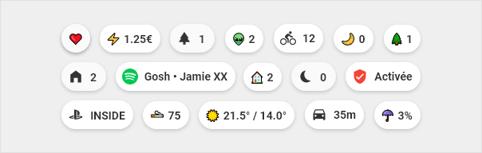
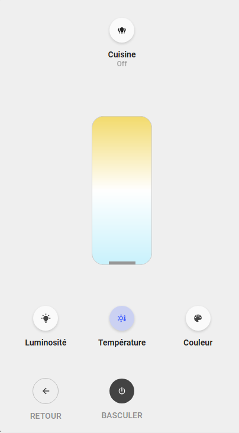
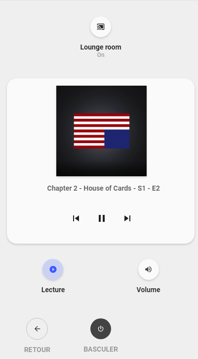
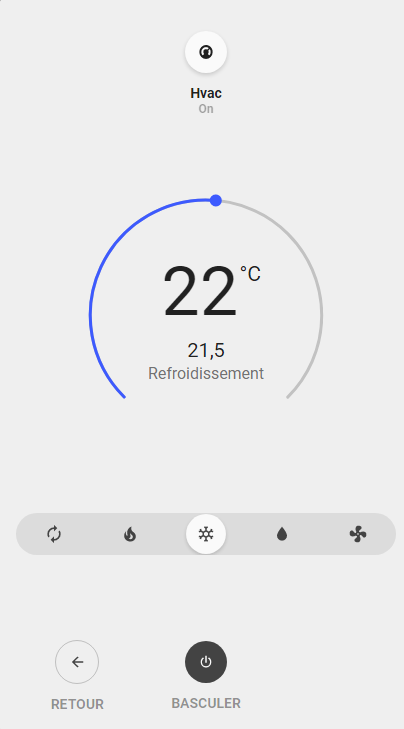
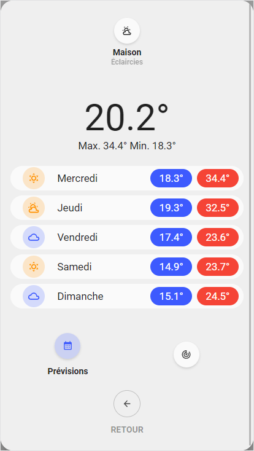

# UI Lovelace Minimalist Cards

Lit / custom-card ports of [UI Lovelace Minimalist](https://github.com/UI-Lovelace-Minimalist/UI), with native Home Assistant UI editors (no `custom:button-card` YAML templates).

> [!WARNING]
> **Work in progress.** This repository is under active development and is **not ready for production**.
> APIs, card types, layouts, and install steps may change without notice. Use only for testing / feedback.

<p align="center">
  
  
  
  
</p>

<p align="center">
  
  
</p>

<p align="center">
  
  
  
  
</p>

More screenshots: [documentation site](https://alessandrosabbadini.github.io/UI-Lovelace-Minimalist-Cards/).

## What we did

This project is a **rewrite / migration**, not a drop-in replacement of the classic HACS integration:

| Before (upstream Minimalist) | After (this repo) |
| --- | --- |
| YAML templates + `custom:button-card` | Lit custom cards (`editable-cards/`) |
| YAML dashboards / template variables | Lovelace **UI mode** + card editors (`getConfigForm`) |
| Bundled frontend deps (button-card, card-mod, …) | Single module: `ulm-editable-cards.js` |
| Community cards as YAML in `custom_cards/` | Ported Lit types next to README (`editable-cards/src/cards/custom/`) |
| Popup YAML (browser_mod + button-card) | Native Lit popups (`openUlmPopup`) |

**Kept from the original project**

- Minimalist themes (`themes/` / integration themefiles): desktop, mobile, mobile-tapbar, iOS-tapbar
- Design language and naming inspired by ULM

**Removed**

- Official card/chip/action YAML templates
- Community YAML card definitions (READMEs live next to each Lit card / chip)
- Bundled HACS frontend dependency packs
- Legacy YAML example dashboards
- Legacy popup YAML / browser_mod templates (replaced by Lit popups)

See also [MIGRATION-EDITABLE-CARDS.md](./MIGRATION-EDITABLE-CARDS.md).

## Status

| Area | Status |
| --- | --- |
| Official cards & chips | Ported |
| Community custom cards & chips | Ported (some MVP / fidelity TBD) |
| Themes | Original Minimalist themes kept |
| Popups | Native Lit dialogs (light, cover, media, thermostat, vacuum, weather, power outlet) |
| HACS / release packaging | Custom repository (Dashboard) ready; repo still **private** |
| Docs | Setup pages aligned to Lit + HACS; usage docs sync from card READMEs |

## Install with HACS (custom repository)

> Repo is still **private**. Only accounts with GitHub access can add it.
> In HACS, for private repos you typically need a GitHub token with `repo` scope
> (HACS → settings / GitHub).

1. HACS → **⋯** → **Custom repositories**
2. Repository: `alessandrosabbadini/UI-Lovelace-Minimalist-Cards`
3. Category: **Dashboard**
4. Download / Install **UI Lovelace Minimalist Cards**
5. Restart Home Assistant if prompted
6. Dashboard **UI mode** → Add card → search **ULM**

HACS looks for `dist/ulm-editable-cards.js` (see `hacs.json`).

## Manual install (without HACS)

```bash
bash scripts/build-hacs.sh
```

1. Copy `dist/ulm-editable-cards.js` → `/config/www/`
2. Lovelace resource: `/local/ulm-editable-cards.js` (**JavaScript Module**)
3. Create a **UI mode** dashboard → Add card → search **ULM**
4. Optional: use the integration only to install **themes**

Details: [editable-cards/README.md](./editable-cards/README.md).

## Credits

This work is derived from [UI Lovelace Minimalist](https://github.com/UI-Lovelace-Minimalist/UI) (MIT).

- Original design: [tben](https://community.home-assistant.io/u/tben/summary)
- Upstream maintainers & contributors — see the [original repository](https://github.com/UI-Lovelace-Minimalist/UI)
- Card/chip docs live next to Lit sources under `editable-cards/src/cards/` (official + community)

## License

[MIT](./LICENSE) — same license family as the upstream project. Keep copyright and license notices when redistributing.
