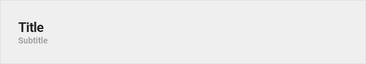
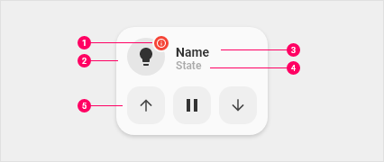
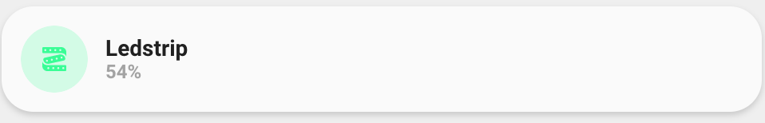
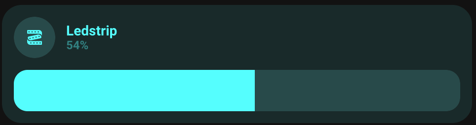
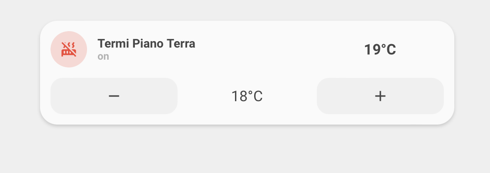
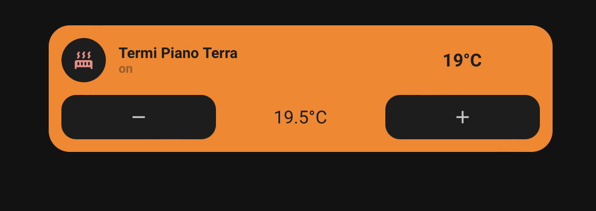
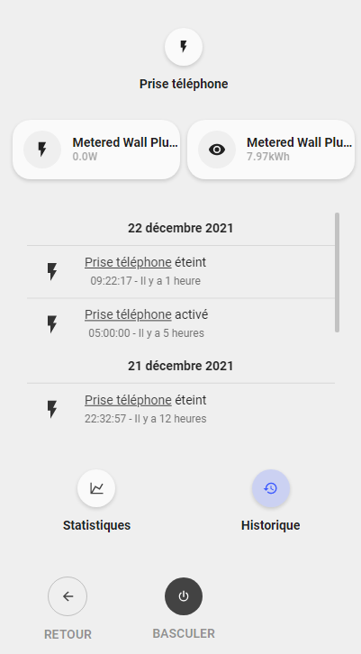
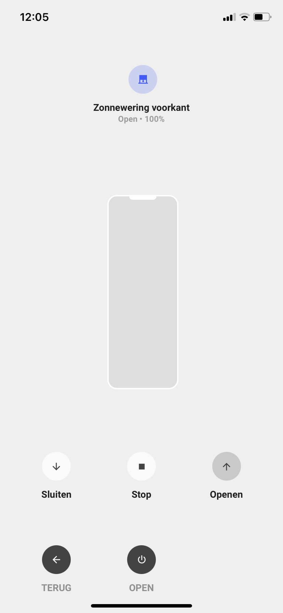

<!-- markdownlint-disable MD046 -->

# UI Lovelace Minimalist Cards

Lit custom cards inspired by [UI Lovelace Minimalist](https://github.com/UI-Lovelace-Minimalist/UI), with native Home Assistant editors — no `custom:button-card` YAML templates.

!!! warning "Work in progress"

    This fork is under active development and **not production-ready**.
    Card types, layouts, and install steps may still change.

  <figure>
    
    <figcaption>Home</figcaption>
  </figure>
  <figure>
    
    <figcaption>Climate</figcaption>
  </figure>
  <figure>
    
    <figcaption>Energy</figcaption>
  </figure>
  <figure>
    
    <figcaption>Presence</figcaption>
  </figure>

## Cards & chips

Official cards, community cards, and chips — all available from the Lovelace card picker under **ULM**.

  
  
  
  

### Lights & climate

  
  
  
  

## Native popups

Tap a card with `enable_popup` to open Minimalist-style dialogs (light, cover, media, thermostat, vacuum, weather, power outlet).

  <figure>
    
    <figcaption>Light</figcaption>
  </figure>
  <figure>
    
    <figcaption>Media</figcaption>
  </figure>
  <figure>
    
    <figcaption>Thermostat</figcaption>
  </figure>
  <figure>
    
    <figcaption>Weather</figcaption>
  </figure>
  <figure>
    
    <figcaption>Power outlet</figcaption>
  </figure>
  <figure>
    
    <figcaption>Cover</figcaption>
  </figure>

## Install

1. HACS → **Custom repositories** → `alessandrosabbadini/UI-Lovelace-Minimalist-Cards` → category **Dashboard**
2. Download / install, restart Home Assistant if prompted
3. Dashboard **UI mode** → Add card → search **ULM**

Themes (desktop, mobile, tapbar) stay available via the integration themefiles.

See [Setup](setup/download.md) and the [root README](https://github.com/alessandrosabbadini/UI-Lovelace-Minimalist-Cards#readme) for details.

## Credits

Derived from [UI Lovelace Minimalist](https://github.com/UI-Lovelace-Minimalist/UI) (MIT) by [tben](https://community.home-assistant.io/u/tben/summary), inspired by [7ahang](https://www.behance.net/gallery/88433905/Redesign-Smart-Home).
