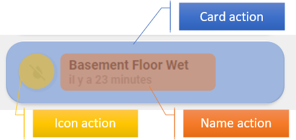

<!-- markdownlint-disable MD046 -->

## Per-card actions

In this Lit package, tap / hold / double-tap are configured on each card in the
Home Assistant UI editor (or equivalent YAML keys), not via a global
`custom_actions.yaml` include.

Typical behaviours:

| Action    | Meaning |
| --------- | ------- |
| none      | No action |
| toggle    | Toggle entity when supported |
| more-info | HA more-info dialog |
| popup     | Native ULM popup when `enable_popup` is on |

Exact field names depend on the card (see that card’s README under
`editable-cards/src/cards/`).

## Popups

`popup` opens `openUlmPopup` for light, cover, media, thermostat, vacuum,
weather, and power outlet. No `browser_mod` is required.
